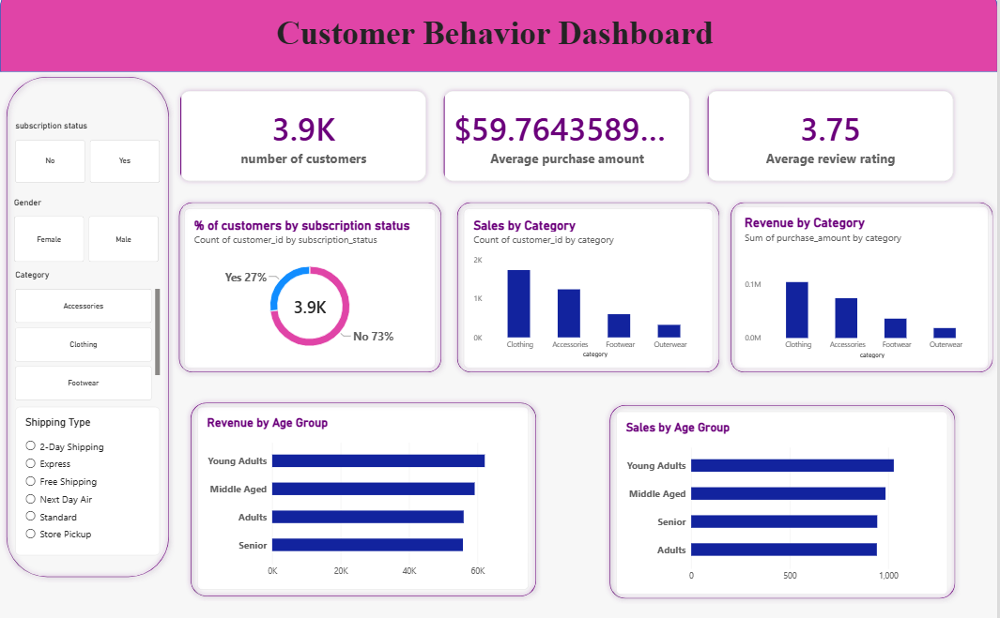

# Customer Shopping Behavior Analysis

An end-to-end data analytics project using Python, Pandas, and PostgreSQL to analyze customer purchasing patterns and shopping behavior.

## Tools & Technologies
- Python
- Pandas
- Jupyter Notebook
- PostgreSQL
- SQL

## Project Objectives
- Analyze customer purchasing behavior.
- Identify top-performing products and categories.
- Compare spending patterns across customer groups.
- Analyze discounts, subscriptions, and payment methods.
- Segment customers based on purchasing history.
- Explore revenue trends and customer retention opportunities.

## Key Skills Demonstrated
- Data cleaning and preprocessing
- Exploratory data analysis (EDA)
- SQL aggregations and joins
- Common Table Expressions (CTEs)
- Window functions and ranking
- Customer segmentation and revenue analysis

## Project Files
- `customer.ipynb` — Data cleaning and preparation.
- `customer_behavior_combined.sql` — SQL queries for basic and advanced analysis.

## Dashboard Preview

The dashboard visualizes customer subscription status, average purchase amount, review ratings, category sales and revenue, and purchasing patterns across age groups. It also includes interactive filters for gender, subscription status, category, and shipping type.

## How to Run
1. Open `customer.ipynb` in Jupyter Notebook.
2. Install the required Python libraries.
3. Run the notebook cells to prepare the data.
4. Load the cleaned dataset into PostgreSQL.
5. Execute the SQL queries in `customer_behavior_combined.sql`.

